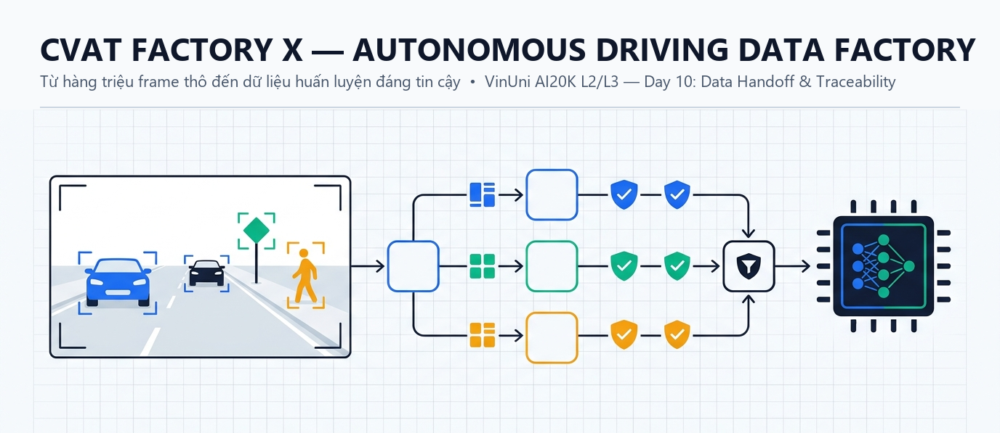

# CVAT Factory X — Data Release Control Tower

<p align="left">
  
  
  
  
</p>

> **Full Presentation & Documentation:** [**Tiếng Việt README (README.vi.md)**](README.vi.md) &nbsp;|&nbsp; [**Presentation Deck (PDF)**](docs/CVAT_Factory_X_Presentation.pdf) &nbsp;|&nbsp; [**Image & Dataset Licenses**](IMAGE_LICENSES.md) &nbsp;|&nbsp; [**MIT License**](LICENSE)

**CVAT Factory X** is a Data Release Control Tower for computer-vision datasets. It layers dataset contracts, immutable cryptographic snapshots, 8-class fault validation (`T1`–`T8`), evidence-backed lineage & blast-radius analysis, Time Machine restore, and a governed release state machine (`DRAFT -> VALIDATED -> APPROVED -> PUBLISHED -> ACCEPTED`) on top of existing `cvat_tools` and Day 10 `coco250` / CVAT job caches without mutating production CVAT or original datasets.

---

## Quickstart

### 1. Environment & Installation

```powershell
# From D:\06-Learning\AIA-VINGROUP\learning\day10\projects
python -m pip install -e .
```

Key dependencies (from `pyproject.toml`): `pydantic>=2.0`, `pyyaml>=6.0`, `fastapi>=0.100`, `uvicorn>=0.20`, `pillow>=10.0`, `numpy>=1.24`, `mlflow>=2.10`, `requests>=2.28`.

### 2. Run the Automated Test Suite

```powershell
python -m pytest tests/ -q
```

### 3. Run the End-to-End Demo & Launch Dashboard

```powershell
# Run the scripted end-to-end demo flow
.\scripts\run_demo.ps1

# Or invoke via the release_control module CLI
python -m release_control demo
python -m release_control dashboard
```

You can also launch the FastAPI dashboard directly via `uvicorn`:

```powershell
uvicorn release_control.dashboard.app:create_app --factory --host 127.0.0.1 --port 8000
```

Then open `http://127.0.0.1:8000/` in your browser.

---

## CLI & API Entrypoints

- **Package script (`pyproject.toml`):** `cvat-release` (`release_control.cli:main`)
- **Module CLI:**
  - `python -m release_control demo` — Bootstrap baseline `coco250` / CVAT job snapshot, inject controlled faults, trigger `HOLD`, trace blast radius, restore clean snapshot, and emit evidence.
  - `python -m release_control dashboard` — Start the FastAPI Control Tower UI & REST API.
- **Dashboard REST Endpoints (`release_control/dashboard/app.py`):**
  - `GET /` — Control Tower web UI
  - `GET /api/health` & `GET /api/state` — System health, snapshots, releases, and validation state
  - `POST /api/demo/bootstrap` — Initialize baseline dataset & snapshot
  - `POST /api/faults/inject` — Deterministically inject `T1`–`T8` faults into a working copy
  - `GET /api/lineage/{node_id}` — Forward/backward lineage & blast radius
  - `POST /api/versions/restore` — Time Machine cryptographic restore
  - `POST /api/releases/{release_id}/approve` — Record mandatory `qc` / `privacy` approvals
  - `POST /api/releases/{release_id}/publish` & `POST /api/releases/{release_id}/accept` — Publish and record downstream consumer ACK
  - `POST /api/benchmark/run` — Execute `FaultBenchmarker` across dev and held-out seeds

---

## Architecture Summary

| Layer | Package | Responsibility |
| :--- | :--- | :--- |
| **Adapters** | `release_control/adapters/` | Read-only `CvatConnector` (`Cvat` + `CvatGateway`, `write_enabled=False`), `DatumaroRoundTripAdapter`, and `MlflowTracker` (`artifacts/mlruns/mlflow.db`). |
| **Contracts** | `release_control/contracts/` | `ContractEngine` backed by `schema.yaml`, `taxonomy.yaml`, and `release_policy.yaml`. |
| **Validators** | `release_control/validators/` | `ValidationEngine` running `structural.py`, `geometry.py`, `semantic.py`, and `privacy.py` checks (`T1`–`T8`). |
| **Fault Lab** | `release_control/fault_lab/` | `FaultInjector` (deterministic seed-based corruption on working copies) and `FaultBenchmarker` (recall, false-hold, false-release, metamorphic tests). |
| **Versions** | `release_control/versions/` | `SnapshotManager` (immutable SHA-256 snapshots) and `RestoreManager` (Time Machine restore with `SnapshotIntegrityError` guard). |
| **Lineage** | `release_control/lineage/` | `LineageTracker` and `ImpactAnalyzer` (BFS blast-radius traversal over verified DB edges and recorded MLflow runs). |
| **Release** | `release_control/release/` | `ReleaseGate` state machine and `EvidenceBuilder` (`ReleasePassport` -> `reports/RELEASE_EVIDENCE.json`). |
| **Dashboard** | `release_control/dashboard/` | FastAPI application (`create_app`) serving the Control Tower UI and JSON APIs. |

---

## Reuse of `cvat_tools` & Day 10 `coco250`

- **Read-Only Live CVAT Probing:** `CvatConnector.probe_cvat_live()` imports `Cvat` (`cvat_tools.core.client`) and `CvatGateway` (`cvat_tools.factory.cvat.gateway`) from `existing_pipelines/src/cvat_tools` with `write_enabled=False`, ensuring production CVAT is never modified.
- **Local Cached CVAT Jobs & `coco250`:** `ControlTowerConfig.auto_discover()` and `CvatConnector` read from:
  - Day 10 `coco250` / `coco250_calib` (`labs/K5-L23-Day10-Dataset-Release-Handover/data_source/`)
  - Cached CVAT jobs (`cvat/data/jobs/edufun/`, including jobs `1975` and `1623`)
  All fault injection, snapshots, and restores operate strictly on copies under `artifacts/` so original source datasets remain untouched.

---

## Documentation

- [Vietnamese Full Presentation README](README.vi.md)
- [Project Presentation Deck (PDF)](docs/CVAT_Factory_X_Presentation.pdf)
- [Architecture Guide](docs/ARCHITECTURE.md)
- [5-Minute Demo Script](docs/DEMO_SCRIPT.md)
- [Acceptance Checklist](docs/ACCEPTANCE.md)
- [Image, Visual Asset & Dataset Licenses](IMAGE_LICENSES.md)
- [Software License (MIT)](LICENSE)


---

## Known limitations (read before use)

- This is a **proof of concept**, not a verified product. See [docs/AUDIT.md](docs/AUDIT.md) for the open findings (e.g. simulated lineage edges, hard-coded privacy flag, unauthenticated approve/publish endpoints in the demo dashboard).
- Demo dataset and course materials are **not** included; `scripts/make_demo_data.py` needs the original Day 10 lab data locally. Images originate from COCO val2017 (CC BY 4.0), see [IMAGE_LICENSES.md](IMAGE_LICENSES.md).
- Scene/job/annotator identities in the lab data are simulated. Approvals and consumer ACK are never auto-generated.
- The 2M-frame scenario is a capacity target, not an achieved result.
