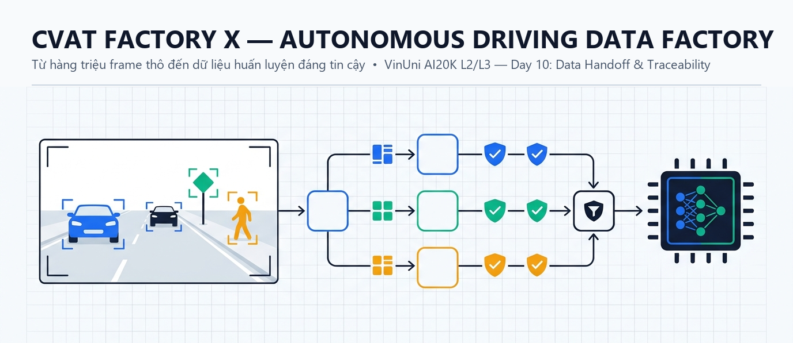
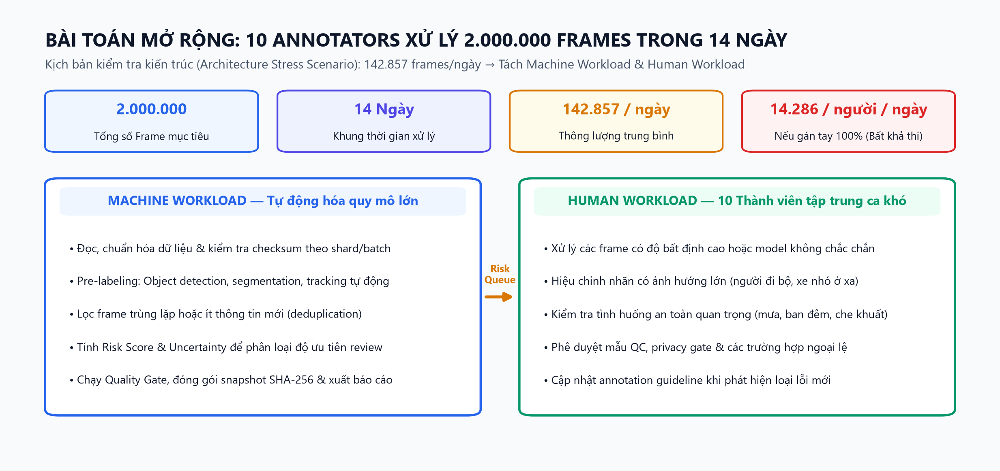
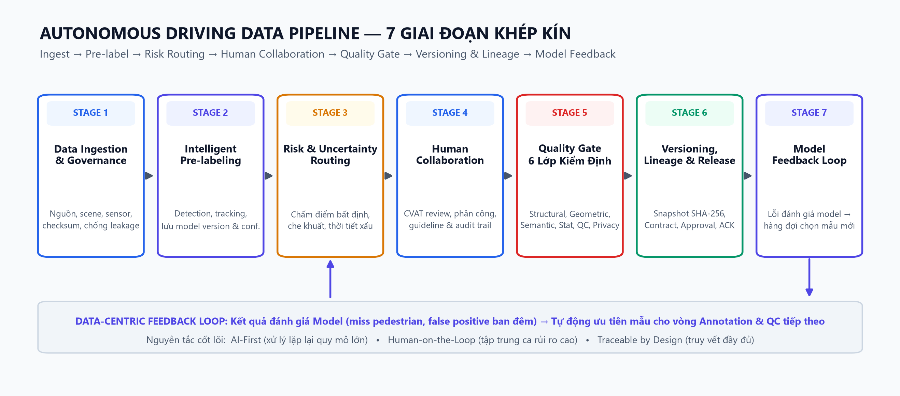
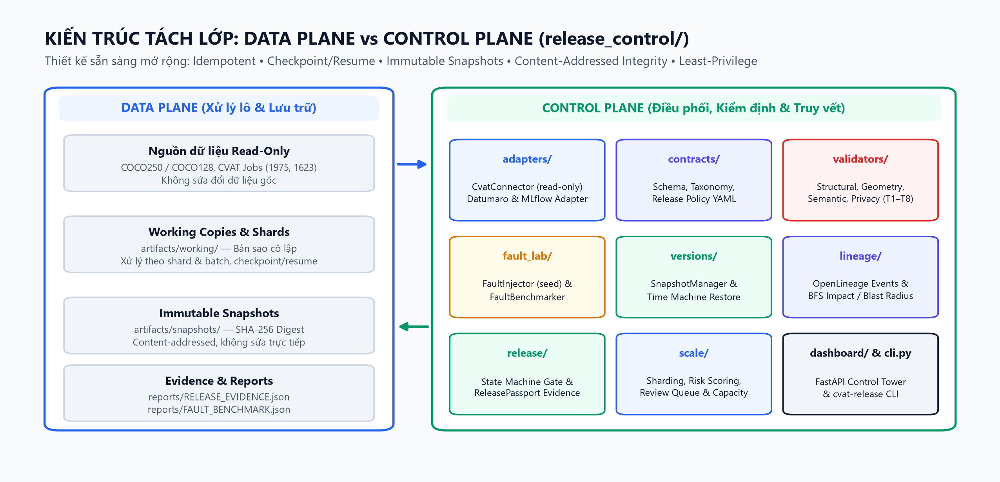
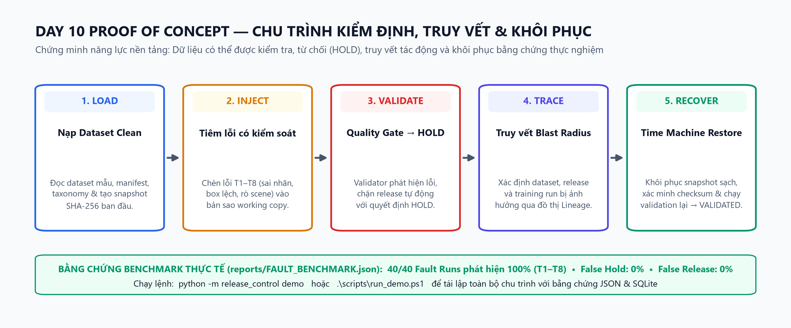
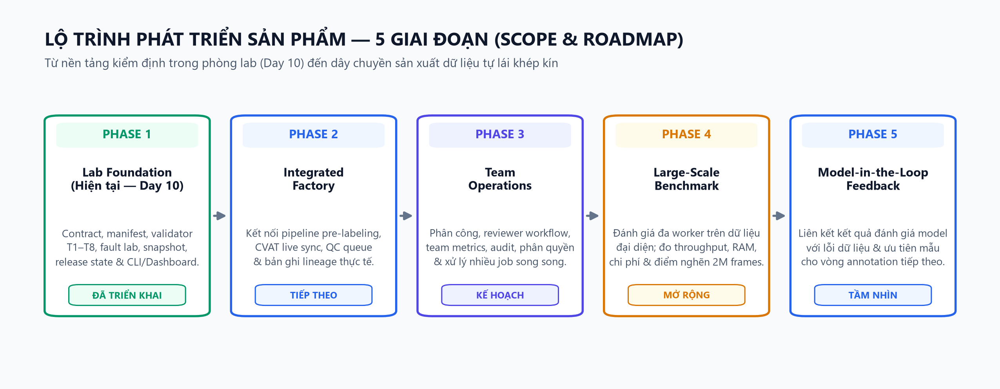

<p align="center">
  <strong>Nền tảng tự động hóa sản xuất, kiểm định và truy vết dữ liệu huấn luyện cho hệ thống xe tự lái</strong><br/>
  <em>VinUni AI20K L2/L3 — Day 10: Data Handoff & Traceability &nbsp;|&nbsp; Proof of Concept → Production-oriented Architecture</em>
</p>

<p align="center">
  <a href="#1-tổng-quan--vì-sao-cần-cvat-factory-x">Tổng quan</a> •
  <a href="#2-tầm-nhìn-sản-phẩm-3-nguyên-tắc-cốt-lõi">Tầm nhìn</a> •
  <a href="#3-bài-toán-mở-rộng-10-annotators--2-triệu-frames">Bài toán mở rộng</a> •
  <a href="#4-autonomous-driving-data-pipeline">Pipeline 7 giai đoạn</a> •
  <a href="#5-kiến-trúc--10-product-modules">Kiến trúc & Modules</a> •
  <a href="#6-day-10-proof-of-concept">Day 10 PoC</a> •
  <a href="#7-hướng-dẫn-triển-khai-nhanh-quickstart">Triển khai nhanh</a>
</p>

---

> **Thông điệp sản phẩm:**  
> *"Từ hàng triệu frame thô đến dữ liệu huấn luyện đáng tin cậy — AI xử lý số lượng lớn, con người tập trung vào những trường hợp quan trọng."*

**Đối tượng sử dụng:** Annotation Team • QC Lead • Data Engineer • ML Engineer • Autonomous Driving Research Team

---

## 1. Tổng quan — Vì sao cần CVAT Factory X?

Hệ thống xe tự lái cần học từ lượng dữ liệu hình ảnh và video khổng lồ: phương tiện, người đi bộ, làn đường, biển báo, vật cản, các tình huống giao thông hiếm và biến đổi môi trường liên tục.

Khi quy mô tăng từ vài trăm lên **hàng triệu frame**, quy trình thủ công truyền thống (mở CVAT → gán nhãn → kiểm tra bằng tay → export rời rạc) bộc lộ 6 nút thắt nghiêm trọng:

| Nút thắt vận hành thủ công | Hệ quả đối với mô hình xe tự lái |
| :--- | :--- |
| **Năng suất tuyến tính theo nhân sự** | Tốc độ phụ thuộc hoàn toàn vào số lượng annotator và thao tác tay. |
| **Chất lượng nhãn thiếu nhất quán** | Sai lệch giữa các annotator, ca làm việc và các phiên bản guideline. |
| **Không thể kiểm tra 100% bằng tay** | Ở quy mô triệu frame, review thủ công toàn bộ là bất khả thi. |
| **Lỗi âm thầm lọt vào Training** | Sai sót nhỏ ở annotation lan thẳng vào quá trình huấn luyện mà không bị chặn. |
| **Mù mờ khi điều tra sự cố** | Khi model suy giảm, không biết chính xác frame, dataset release hay training run nào bị ảnh hưởng. |
| **Chi phí quản lý phình to** | Mở rộng đội ngũ đồng nghĩa với tăng vọt khối lượng điều phối, review và sửa lỗi. |

**CVAT Factory X** giải quyết triệt để nút thắt này bằng cách biến annotation từ công việc thủ công thành **dây chuyền sản xuất dữ liệu có đo lường, kiểm soát và khả năng truy vết**:

`Ingest → Pre-label → Risk Scoring → Human Review → Quality Gate → Dataset Release → Model Feedback`

---

## 2. Tầm nhìn sản phẩm: 3 Nguyên tắc cốt lõi

CVAT Factory X **không thay thế CVAT**. CVAT tiếp tục là môi trường annotation và review; Factory đóng vai trò **hệ thống điều phối (Control Tower)** xung quanh CVAT, kết nối xử lý tự động với con người và pipeline huấn luyện AI dựa trên 3 nguyên tắc:

1. **AI-First:** Tự động hóa các tác vụ lặp lại ở quy mô lớn (pre-labeling, kiểm tra cấu trúc, phát hiện bất thường, chuẩn hóa và đóng gói dữ liệu).
2. **Human-on-the-Loop:** Con người giám sát chính sách, kiểm tra các trường hợp rủi ro cao và phê duyệt quyết định quan trọng thay vì can thiệp từng frame.
3. **Traceable by Design:** Mọi phiên bản dataset, kết quả kiểm định, quyết định phê duyệt và liên kết tới training run đều có bằng chứng truy xuất được.

> **Giá trị cuối cùng** không nằm ở số lượng annotation được tạo ra, mà ở **khả năng cung cấp dữ liệu đúng, đủ, có thể kiểm chứng** cho quá trình phát triển mô hình xe tự lái.

---

## 3. Bài toán mở rộng: 10 Annotators → 2 Triệu Frames



Xét kịch bản kiểm tra khả năng mở rộng kiến trúc *(architecture stress scenario, chưa phải năng suất thực tế đã benchmark)*: **10 thành viên xử lý 2.000.000 frames trong 14 ngày**.

- Thông lượng trung bình cần đạt: **142.857 frames/ngày**.
- Nếu gán nhãn thủ công 100%, mỗi thành viên phải xử lý **14.286 frames/ngày** — điều bất khả thi.

Do đó, CVAT Factory X tách biệt rõ **Machine Workload** và **Human Workload**, đồng thời thiết kế sẵn 7 năng lực mở rộng:

1. Phân phối dữ liệu thành các **shard/job độc lập** cho nhiều worker.
2. Xử lý theo lô có **checkpoint & resume** sau sự cố.
3. Tự động đẩy **frame rủi ro cao / độ bất định lớn** vào hàng đợi review.
4. Dùng chung **taxonomy, guideline và quality policy** trên toàn đội ngũ.
5. Phân quyền, phân công và ghi nhận trách nhiệm rõ ràng.
6. Chỉ xử lý lại đúng **những frame bị ảnh hưởng** khi thay đổi model hoặc guideline.
7. Đóng gói các **dataset release có thể tái lập** cho team training.

---

## 4. Autonomous Driving Data Pipeline



Pipeline gồm 7 giai đoạn liên kết chặt chẽ từ lúc thu nhận dữ liệu thô đến vòng phản hồi cải thiện mô hình:

| Giai đoạn | Trọng tâm kỹ thuật | Giá trị cho xe tự lái |
| :--- | :--- | :--- |
| **1. Data Ingestion & Governance** | Ghi nhận source, scene, timestamp, sensor, checksum; nhận diện chuỗi thời gian | Ngăn **scene leakage** giữa `train / val / test`, đảm bảo nguồn gốc minh bạch |
| **2. Intelligent Pre-labeling** | Chạy detection, segmentation, tracking; lưu model version & confidence | Giảm thời gian tạo nhãn nháp, dồn sức người cho đối tượng khó |
| **3. Risk & Uncertainty Routing** | Chấm điểm rủi ro: độ bất định, che khuất, vật thể xa, mưa/đêm, class an toàn | Ưu tiên nguồn lực QC cho dữ liệu tác động mạnh nhất tới hành vi xe |
| **4. Human Collaboration** | Phối hợp trên CVAT, tránh trùng lặp job, lưu lịch sử quyết định ca mơ hồ | Mở rộng đội ngũ mà vẫn giữ tính nhất quán và trách nhiệm giải trình |
| **5. Quality Gate (6 Lớp)** | Structural • Geometric • Semantic • Statistical • Human QC • Privacy | Chặn dữ liệu lỗi trước khi đi vào quá trình huấn luyện model |
| **6. Versioning, Lineage & Release** | Dataset ID, manifest, SHA-256 hashes, contract, approval & consumer ACK | Biến dữ liệu thành tài sản kiểm soát được, khôi phục tức thì khi có lỗi |
| **7. Model Feedback Loop** | Liên kết kết quả đánh giá model ngược về dataset version & hàng đợi lấy mẫu | Hình thành chu trình **Data-centric AI** liên tục cải thiện chất lượng dữ liệu |

> Xem chi tiết cấu trúc kiểm định 6 lớp và ánh xạ mã lỗi `T1`–`T8` tại: [**docs/PIPELINE_AND_MODULES.md**](docs/PIPELINE_AND_MODULES.md)

---

## 5. Kiến trúc & 10 Product Modules



Hệ thống tách biệt **Control Plane** (quản lý job, manifest, policy, phân quyền, validation, lineage, release) và **Data Plane** (đọc frame, inference, chuyển đổi định dạng, ghi artifacts, snapshot theo lô). Mọi thao tác trên dữ liệu nguồn (`coco250`, CVAT jobs) đều chạy ở chế độ **chỉ đọc (`write_enabled=False`)**; toàn bộ fault injection và restore chỉ tác động lên bản sao trong `artifacts/`.

### Ánh xạ 10 Product Modules từ PRD V2.0 sang Codebase thực tế

| Module (PRD V2.0) | Chức năng chính | Triển khai trong `release_control/` |
| :--- | :--- | :--- |
| **CVAT Connector** | Đồng bộ annotation, job & metadata ở chế độ read-only | `adapters/cvat_adapter.py`, `adapters/datumaro_adapter.py` |
| **Pre-label Factory** | Tạo annotation nháp & lưu provenance | Kết nối qua `existing_pipelines/` & adapter |
| **Smart Review Queue** | Chấm điểm rủi ro & phân phối frame ưu tiên | `scale/risk.py`, `scale/review_queue.py` |
| **Team Operations** | Phân công, sharding, ước lượng năng lực xử lý | `scale/sharding.py`, `scale/capacity.py` |
| **Quality Gate** | Kiểm tra 6 lớp & quyết định `VALIDATED` / `HOLD` | `validators/` (`structural`, `geometry`, `semantic`, `privacy`, `gate.py`) |
| **Fault Injection Lab** | Chủ động tiêm lỗi `T1`–`T8` & benchmark bộ kiểm định | `fault_lab/inject.py`, `fault_lab/benchmark.py` |
| **Dataset Version Manager** | Snapshot bất biến SHA-256 & Time Machine Restore | `versions/snapshot.py`, `versions/restore.py` |
| **Lineage & Impact Graph** | Truy vết nguồn gốc & bán kính ảnh hưởng (BFS) | `lineage/events.py`, `lineage/impact.py`, `adapters/mlflow_adapter.py` |
| **Release Control** | State machine (`DRAFT → VALIDATED → APPROVED → PUBLISHED → ACCEPTED`) | `release/gate.py`, `release/evidence.py` |
| **Operations Dashboard** | Theo dõi quy trình, demo & kiểm chứng trực quan | `dashboard/app.py`, `dashboard/static/` |

---

## 6. Day 10 Proof of Concept



Day 10 không nhằm chứng minh đã xử lý 2 triệu frame, mà chứng minh **năng lực nền tảng bắt buộc trước khi mở rộng**: dữ liệu do Factory tạo ra có thể được **kiểm tra, từ chối (`HOLD`), truy vết và khôi phục** bằng bằng chứng thực nghiệm.

### Kết quả Benchmark Bộ Kiểm Định (`reports/FAULT_BENCHMARK.json`)

| Chỉ số kiểm chứng | Kết quả ghi nhận | Ý nghĩa |
| :--- | :---: | :--- |
| **Fault Recall (`T1`–`T8`)** | **100%** (40/40 runs trên dev & held-out seeds) | Phát hiện toàn bộ 8 nhóm lỗi cấu trúc, hình học, ngữ nghĩa, rò rỉ scene |
| **False Hold Rate** | **0.0%** | Không chặn nhầm dữ liệu sạch |
| **False Release Rate** | **0.0%** | Không để lọt dữ liệu lỗi qua Quality Gate |
| **Metamorphic Tests** | **Passed** | Bất biến với thứ tự manifest; 0 cảnh báo giả trên bản sạch |
| **Độ trễ kiểm định trung bình** | **478.5 ms** | Phù hợp tích hợp kiểm tra tự động trong pipeline |

> Xem hướng dẫn chạy từng bước và kịch bản demo tại: [**docs/DAY10_POC_GUIDE.md**](docs/DAY10_POC_GUIDE.md) và [**docs/DEMO_SCRIPT.md**](docs/DEMO_SCRIPT.md)

---

## 7. Hướng dẫn triển khai nhanh (Quickstart)

### Bước 1: Cài đặt môi trường

```powershell
# Tại thư mục D:\06-Learning\AIA-VINGROUP\learning\day10\projects
python -m pip install -e .
```

### Bước 2: Chạy bộ kiểm thử tự động

```powershell
python -m pytest tests/ -q
```

### Bước 3: Chạy Demo End-to-End & Khởi động Control Tower Dashboard

```powershell
# Chạy trọn vẹn chu trình Day 10 PoC (Load -> Inject -> HOLD -> Trace -> Restore)
.\scripts\run_demo.ps1

# Hoặc chạy qua CLI module
python -m release_control demo
python -m release_control dashboard
```

Hoặc khởi chạy trực tiếp FastAPI Dashboard bằng `uvicorn`:

```powershell
uvicorn release_control.dashboard.app:create_app --factory --host 127.0.0.1 --port 8000
```

Truy cập `http://127.0.0.1:8000/` để thao tác trực tiếp trên giao diện Control Tower.

---

## 8. Lộ trình phát triển & Ranh giới an toàn



### Chỉ số thành công sản phẩm (Product Success Metrics)

Hệ thống đánh giá hiệu quả toàn diện trên 4 trụ cột thay vì chỉ đếm số frame pre-label:
- **Scale & Operations:** Frames/giờ, frames qua release gate/ngày, GPU-seconds/frame, thời gian phục hồi sau lỗi, phút review/frame đạt chuẩn.
- **Quality:** Precision/Recall theo class & ngữ cảnh, Critical Error Escape Rate, QC Defect Rate, False Release / False Hold, Reviewer Agreement.
- **Traceability:** Tỷ lệ artifacts có manifest & checksum, tỷ lệ release đủ contract & QC evidence, thời gian khoanh vùng lỗi, tỷ lệ khôi phục thành công.
- **Business Value:** Giờ công annotation/review tiết kiệm được, chi phí trên mỗi object đạt chuẩn, Lead Time từ raw data → training-ready release.

### Non-goals & Ranh giới an toàn

- **Không trực tiếp điều khiển phương tiện** và không khẳng định xe tự lái an toàn chỉ dựa trên chất lượng annotation.
- **Không giả mạo bằng chứng phê duyệt:** Hệ thống không tự tuyên bố đã có human review, approval hay consumer ACK khi chưa có xác nhận thực tế (các run giả lập trong demo được gắn cờ `simulated_demo`).
- **Bảo vệ dữ liệu nguồn:** Không sửa đổi hoặc xóa dữ liệu production/shared CVAT khi chưa có quyền và quy trình phê duyệt.

---

## 9. Bộ tài liệu liên quan

| Tài liệu | Nội dung |
| :--- | :--- |
| [**README.md**](README.md) | Tài liệu kỹ thuật nhanh (English), danh sách REST API & CLI entrypoints |
| [**docs/CVAT_Factory_X_Presentation.pdf**](docs/CVAT_Factory_X_Presentation.pdf) | Bộ slide thuyết trình dự án CVAT Factory X (PDF Deck) |
| [**docs/PIPELINE_AND_MODULES.md**](docs/PIPELINE_AND_MODULES.md) | Chi tiết Pipeline 7 giai đoạn, 10 Modules & Quality Gate `T1`–`T8` |
| [**docs/GUIDELINE_SSOT_WORKFLOW.md**](docs/GUIDELINE_SSOT_WORKFLOW.md) | Quy trình cập nhật Guideline SSOT liên tục & Annotator ACK (hiện trạng + Phase 2/3) |
| [**docs/DAY10_POC_GUIDE.md**](docs/DAY10_POC_GUIDE.md) | Hướng dẫn vận hành Day 10 PoC (Load → Inject → Validate → Trace → Recover) |
| [**docs/ARCHITECTURE.md**](docs/ARCHITECTURE.md) | Kiến trúc `release_control/` & phạm vi tái sử dụng từ `existing_pipelines/` |
| [**docs/DEMO_SCRIPT.md**](docs/DEMO_SCRIPT.md) | Kịch bản trình bày demo 5 phút |
| [**docs/ACCEPTANCE.md**](docs/ACCEPTANCE.md) | Danh mục tiêu chí nghiệm thu Day 10 |
| [**IMAGE_LICENSES.md**](IMAGE_LICENSES.md) | Chi tiết nguồn gốc & bản quyền hình ảnh, sơ đồ, slide và dataset mẫu |
| [**LICENSE**](LICENSE) | Giấy phép mã nguồn mở MIT của dự án |

---

<p align="center">
  <em>“Chúng tôi không chỉ tự động hóa thao tác gán nhãn. Chúng tôi xây dựng một dây chuyền để dữ liệu đi từ camera đến mô hình AI một cách nhanh hơn, nhất quán hơn và có thể truy vết khi xảy ra lỗi.”</em>
</p>
