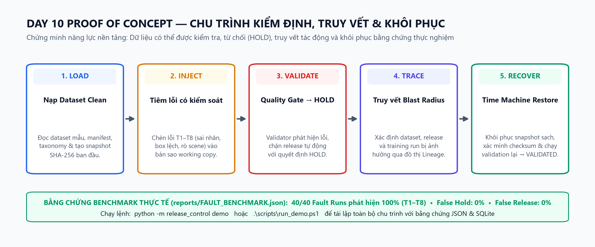

# Hướng dẫn Vận hành Day 10 Proof of Concept



Tài liệu này hướng dẫn chạy và trình bày **Day 10 Proof of Concept** — kịch bản chứng minh năng lực cốt lõi của **CVAT Factory X**: *dữ liệu đầu ra có thể được kiểm tra, từ chối (`HOLD`), truy vết bán kính ảnh hưởng và khôi phục nguyên trạng bằng bằng chứng thực nghiệm.*

---

## 1. Chu trình 5 bước của Day 10 PoC

Mọi thao tác đều chạy trên bản sao cô lập trong `artifacts/`, tuyệt đối **không** làm thay đổi dữ liệu nguồn (`coco250` / CVAT jobs).

1. **Load:** Nạp dataset mẫu, đọc `schema.yaml`, `taxonomy.yaml`, `release_policy.yaml` và tạo snapshot bất biến (`SHA-256`) cho phiên bản sạch `v1_clean`.
2. **Inject:** Sử dụng `FaultInjector` để chủ động chèn lỗi có kiểm soát (`T1`–`T8`) vào bản sao làm việc `v1_corrupt`.
3. **Validate (`HOLD`):** `ValidationEngine` chạy kiểm tra đa tầng, phát hiện vi phạm và ra quyết định **`HOLD`**, ngăn bản corrupt đi vào release.
4. **Trace (Blast Radius):** `ImpactAnalyzer` duyệt đồ thị Lineage (`artifacts/lineage/openlineage.jsonl` & SQLite + MLflow runs) để xác định chính xác dataset, release và training run nào bị ảnh hưởng.
5. **Recover:** `RestoreManager` thực hiện **Time Machine Restore** từ snapshot `v1_clean`, kiểm tra lại toàn bộ checksum SHA-256 (chặn ngay nếu snapshot bị hư hại qua `SnapshotIntegrityError`), chạy lại Quality Gate → đạt **`VALIDATED`** và xuất bằng chứng `reports/RELEASE_EVIDENCE.json`.

> **Lưu ý minh bạch:** Trong bản demo phòng lab, các training run được đánh dấu rõ `run_origin = simulated_demo`. Hệ thống không tự nhận đã có human review hay consumer ACK thật khi chưa được ghi nhận qua bước phê duyệt.

---

## 2. Chạy Demo qua CLI

### Cách 1: Script PowerShell tự động (Khuyến nghị)

```powershell
# Tại thư mục D:\06-Learning\AIA-VINGROUP\learning\day10\projects
.\scripts\run_demo.ps1
```

### Cách 2: Chạy trực tiếp bằng Python module

```powershell
# Chạy toàn bộ kịch bản end-to-end (Load -> Inject -> HOLD -> Trace -> Recover)
python -m release_control demo
```

Sau khi chạy xong, kiểm tra các tệp bằng chứng được sinh ra:
- `reports/RELEASE_EVIDENCE.json` — Hồ sơ `ReleasePassport` đầy đủ chữ ký & lịch sử trạng thái.
- `reports/FAULT_BENCHMARK.json` — Kết quả benchmark 8 nhóm lỗi `T1`–`T8` trên dev & held-out seeds.
- `artifacts/lineage/openlineage.jsonl` — Nhật ký sự kiện Lineage theo chuẩn OpenLineage.

---

## 3. Thao tác trên Control Tower Dashboard

Khởi động FastAPI Dashboard:

```powershell
uvicorn release_control.dashboard.app:create_app --factory --host 127.0.0.1 --port 8000
```

Mở trình duyệt tại **`http://127.0.0.1:8000/`**. Các API chính phục vụ trình diễn trực tiếp:

| Thao tác trên UI / Demo | Endpoint tương ứng |
| :--- | :--- |
| Khởi tạo dữ liệu nền & snapshot sạch | `POST /api/demo/bootstrap` |
| Tiêm lỗi `T1`–`T8` theo seed vào bản working | `POST /api/faults/inject` |
| Xem đồ thị Lineage & Blast Radius | `GET /api/lineage/{node_id}` |
| Khôi phục Time Machine từ snapshot sạch | `POST /api/versions/restore` |
| Phê duyệt bắt buộc (`qc` / `privacy`) | `POST /api/releases/{release_id}/approve` |
| Publish & ghi nhận Consumer ACK | `POST /api/releases/{release_id}/publish` & `/accept` |
| Chạy benchmark phát hiện lỗi | `POST /api/benchmark/run` |
