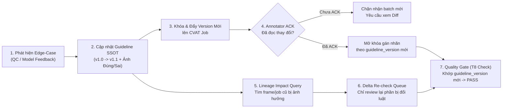

# Quy trình Cập nhật Guideline Chuẩn SSOT Liên tục cho Annotator

> **Phạm vi tài liệu:** Tài liệu này tách bạch rõ **những gì hệ thống đã có ở Day 10** và **luồng cập nhật Guideline SSOT liên tục (Phase 2/3)** dành cho đội ngũ gán nhãn tay (Manual Annotators & Reviewers).

---

## 1. Hiện trạng hệ thống (Đã có ở Day 10)

| Thành phần | Trạng thái | Vị trí trong mã nguồn |
| :--- | :---: | :--- |
| **Taxonomy & Guideline Reference tĩnh** | Đã có | `release_control/contracts/taxonomy.yaml` (`version: "1.0.0"`, `guideline_ref`) |
| **Chặn lệch chuẩn Guideline (`T8_GUIDELINE_MISMATCH`)** | Đã có | `release_control/validators/semantic.py` & `fault_lab/inject.py` |
| **Release Policy & Transition Gate** | Đã có | `release_control/contracts/release_policy.yaml` & `release/gate.py` |
| **Truy vết ảnh hưởng (Lineage / Impact)** | Đã có | `release_control/lineage/impact.py` |
| **Guideline SSOT Registry + Diff trực quan** | Đề xuất Phase 2 | — |
| **Bắt buộc Annotator ACK trước khi gán tiếp** | Đề xuất Phase 2 | — |
| **Delta Re-check tự động theo class bị đổi luật** | Đề xuất Phase 3 | — |

---

## 2. Luồng cập nhật Guideline SSOT liên tục (Continuous Guideline SSOT Flow)

Khi có edge-case mới từ QC, Model Feedback hoặc thay đổi chính sách an toàn, toàn bộ team gán nhãn tay phải nhận được bản cập nhật đồng nhất từ **một nguồn chân lý duy nhất (Single Source of Truth)**:

---

## 3. Bốn nguyên tắc vận hành SSOT cho đội gán nhãn tay

1. **Một nguồn duy nhất (Single Source of Truth):** Mọi annotator, reviewer và validator tự động đều đọc cùng một `guideline_version` từ `contracts/` — không gửi luật mới rời rạc qua chat mà không cập nhật version.
2. **Minh họa trực quan (Visual Examples First):** Mỗi lần nâng phiên bản (`v1.0 → v1.1`) bắt buộc kèm cặp ảnh **Đúng (PASS) / Sai (FAIL)** cho đúng trường hợp vừa thay đổi.
3. **Bắt buộc xác nhận (Mandatory Annotator ACK):** Thành viên gán nhãn tay phải xác nhận đã đọc changelog trước khi mở job mới; lịch sử ACK được ghi vào audit trail.
4. **Kiểm tra lại theo vùng ảnh hưởng (Delta Re-validation):** Nhờ `ImpactAnalyzer`, khi chỉ thay đổi quy ước của một class (ví dụ: *người đi bộ bị che khuất > 50%*), hệ thống chỉ đưa các job/frame có liên quan vào hàng đợi `REWORK` thay vì bắt gán lại toàn bộ dataset.
