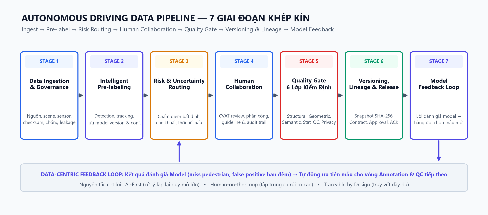
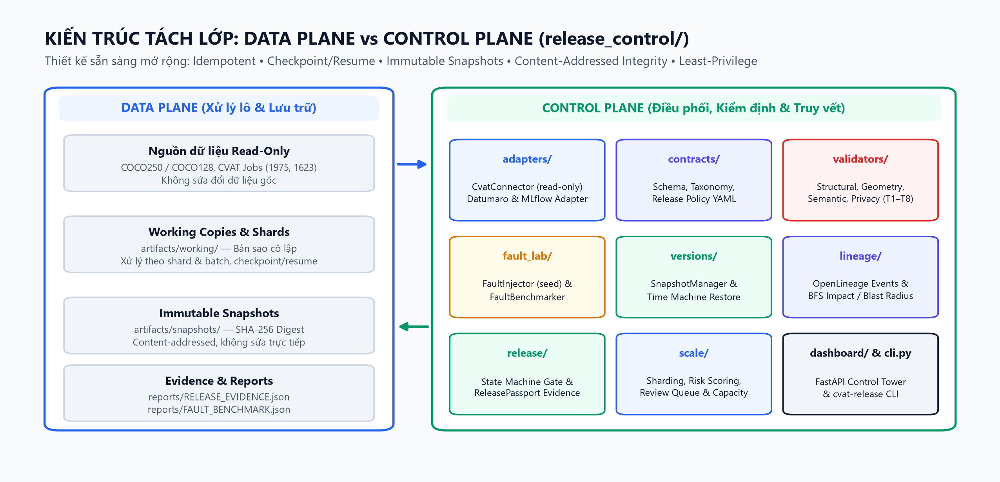
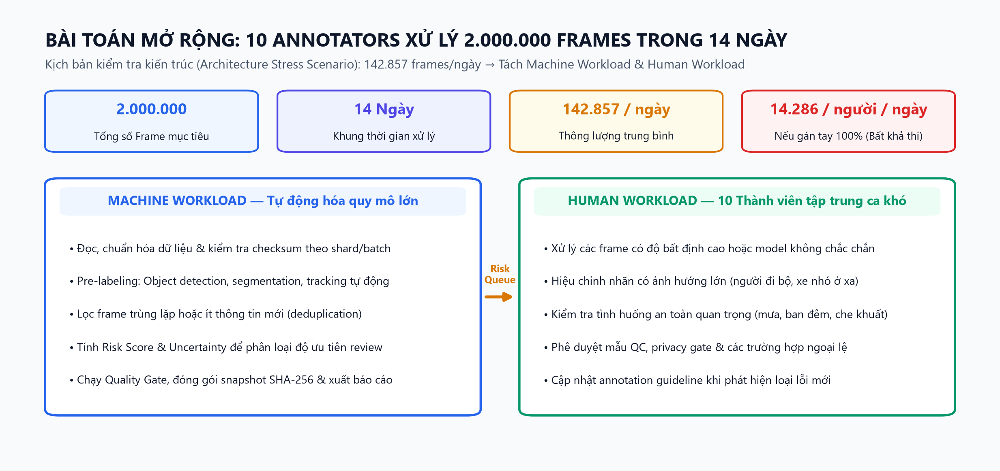

# Chi tiết Pipeline 7 Giai đoạn & Hệ thống Quality Gate

Tài liệu này mô tả chi tiết từng giai đoạn trong dây chuyền sản xuất dữ liệu xe tự lái **CVAT Factory X**, cơ chế kiểm định **6 lớp Quality Gate**, bộ tiêm lỗi **8 nhóm (`T1`–`T8`)** và kiến trúc tách lớp **Control Plane / Data Plane**.

---

## 1. Chi tiết 7 giai đoạn Autonomous Driving Data Pipeline

### Stage 1 — Data Ingestion & Governance
- **Đầu vào:** Dữ liệu camera/video từ nguồn được cấp quyền (`coco250`, CVAT job caches `1975`, `1623`).
- **Xử lý:** Ghi nhận `source`, `scene`, `timestamp`, `sensor`, `checksum` (SHA-256) và tạo manifest chuẩn hóa.
- **Chống Data Leakage:** Nhận diện các frame thuộc cùng một `scene` hoặc chuỗi thời gian để không bị chia chéo giữa `train`, `validation` và `test`.
- **Giá trị xe tự lái:** Đảm bảo nguồn gốc dữ liệu minh bạch, tránh đánh giá mô hình sai lệch do rò rỉ scene.

### Stage 2 — Intelligent Pre-labeling
- **Đầu vào:** Frame đã chuẩn hóa.
- **Xử lý:** Lựa chọn mô hình phù hợp theo loại nhãn (detection, segmentation, keypoints, tracking), chất lượng ảnh và ngân sách tính toán đã benchmark.
- **Provenance bắt buộc:** Mọi nhãn AI sinh ra phải lưu kèm `model_version`, thời điểm xử lý, cấu hình và `confidence`.
- **Giá trị xe tự lái:** Cắt giảm công việc gán nhãn lặp lại để con người tập trung vào đối tượng khó.

### Stage 3 — Risk & Uncertainty Routing
Không phải mọi frame đều có giá trị kiểm tra như nhau. Factory chấm điểm rủi ro dựa trên 7 tín hiệu:
1. Độ bất định của dự đoán (`uncertainty` / entropy).
2. Đối tượng bị che khuất (`occlusion`).
3. Người đi bộ hoặc phương tiện nhỏ ở khoảng cách xa.
4. Điều kiện ánh sáng khó, mưa, chói sáng hoặc ban đêm.
5. Tình huống hiếm hoặc phân bố dữ liệu khác thường (`OOD`).
6. Sai khác giữa nhiều mô hình hoặc giữa các lần xử lý.
7. Các lớp có độ nghiêm trọng cao theo chính sách an toàn (`pedestrian`, `cyclist`, `traffic_light`).

> **Lưu ý:** Điểm rủi ro dùng để **phân loại ưu tiên kiểm tra**, không phải bằng chứng trực tiếp chứng minh frame đã chính xác.

### Stage 4 — Human Collaboration
- Phối hợp nhiều annotator và reviewer trên môi trường **CVAT**.
- Thành viên theo dõi trực tiếp job được giao, trạng thái, danh sách issue, guideline và lịch sử thay đổi.
- Ngăn giao trùng một job cho nhiều người ngoài ý muốn; lưu lại quyết định xử lý các ca mơ hồ làm tư liệu huấn luyện nội bộ.

### Stage 5 — Quality Gate (6 Lớp Kiểm Định)
Mọi dataset trước khi bàn giao đều phải đi qua `ValidationEngine` (`release_control/validators/gate.py`):

| Lớp kiểm tra | Nội dung xác minh | Module xử lý |
| :--- | :--- | :--- |
| **1. Structural** | Đúng schema, định dạng file, đủ ảnh theo manifest, khớp SHA-256 | `validators/structural.py` |
| **2. Geometric** | Bounding box / mask / keypoint nằm trong khung ảnh, kích thước hợp lệ | `validators/geometry.py` |
| **3. Semantic** | Class mapping, taxonomy và guideline nhất quán (`taxonomy.yaml`) | `validators/semantic.py` |
| **4. Statistical** | Phát hiện dịch chuyển phân bố dữ liệu hoặc rò rỉ scene bất thường | `validators/structural.py` / `gate.py` |
| **5. Human QC** | Bằng chứng kiểm tra mẫu đạt ngưỡng theo `release_policy.yaml` | `release/gate.py` |
| **6. Privacy** | Kiểm tra yêu cầu quyền riêng tư (che biển số/khuôn mặt) trước bàn giao | `validators/privacy.py` |

Các lỗi kiểm chứng được bằng máy sẽ bị chặn tự động với trạng thái **`HOLD`**. Những trường hợp thiếu bằng chứng được đánh dấu để QC Lead xem xét trước khi cấp phép.

### Stage 6 — Versioning, Lineage & Release
Mỗi bản phát hành dữ liệu (`ReleasePassport`) lưu đầy đủ danh tính:
- `Dataset ID` và `Release Version` (`DRAFT → VALIDATED → APPROVED → PUBLISHED → ACCEPTED`).
- Manifest, file SHA-256 hashes và contract version.
- Taxonomy / guideline version và kết quả validation + QC.
- Provenance nguồn/job/run, quyết định phê duyệt (`qc`, `privacy`) và thông tin **Consumer Acceptance (ACK)**.

Khi phát hiện một class mapping sai, `ImpactAnalyzer` (`release_control/lineage/impact.py`) thực hiện duyệt đồ thị (BFS) để chỉ ra toàn bộ dataset, release và training run bị ảnh hưởng, sau đó `RestoreManager` khôi phục snapshot sạch và xác minh lại digest.

### Stage 7 — Model Feedback Loop
Kết quả đánh giá model (bỏ sót người đi bộ, nhận diện nhầm vật cản, suy giảm hiệu năng ban đêm) được liên kết ngược về đúng `dataset_version` đã dùng để huấn luyện, từ đó tạo yêu cầu lấy mẫu bổ sung cho vòng annotation và QC tiếp theo.

---

## 2. Bộ kiểm thử 8 lớp lỗi (`T1`–`T8`) trong Fault Injection Lab

`FaultInjector` (`release_control/fault_lab/inject.py`) chủ động tạo lỗi có seed cố định trên bản sao `artifacts/working/` để kiểm chứng khả năng phòng vệ của Quality Gate:

| Mã lỗi | Tên lỗi | Nhóm kiểm định | Kết quả Benchmark (`FAULT_BENCHMARK.json`) |
| :--- | :--- | :--- | :---: |
| **`T1_MISSING_IMAGE`** | Thiếu file ảnh so với manifest | Structural | Recall **100%** |
| **`T2_WRONG_HASH`** | Sai lệch checksum SHA-256 (file bị sửa/hỏng) | Structural | Recall **100%** |
| **`T3_INVALID_CLASS`** | Nhãn class không nằm trong `taxonomy.yaml` | Semantic | Recall **100%** |
| **`T4_BBOX_OUT_OF_BOUNDS`** | Bounding box vượt ra ngoài kích thước ảnh | Geometric | Recall **100%** |
| **`T5_BBOX_DRIFT`** | Bounding box bị dịch lệch hoặc suy biến kích thước | Geometric | Recall **100%** |
| **`T6_CLASS_SWAP`** | Tráo đổi nhãn giữa các class (vd: `car` ↔ `person`) | Semantic | Recall **100%** |
| **`T7_SCENE_LEAK`** | Trùng lặp scene giữa các tập `train` / `val` / `test` | Governance / Split | Recall **100%** |
| **`T8_GUIDELINE_MISMATCH`** | Sai lệch quy ước gán nhãn theo phiên bản guideline | Semantic | Recall **100%** |

---

## 3. Kiến trúc Scale: Control Plane vs Data Plane

Để sẵn sàng mở rộng lên quy mô hàng triệu frame, kiến trúc tuân thủ 9 nguyên tắc kỹ thuật bắt buộc:
- **Idempotent processing:** Chạy lại cùng một job không sinh dữ liệu trùng.
- **Checkpoint / Resume:** Tiếp tục từ phần đã hoàn tất khi gặp sự cố.
- **Immutable snapshots:** Bản release không thể bị chỉnh sửa trực tiếp.
- **Content-addressed integrity:** Kiểm chứng toàn vẹn dữ liệu bằng SHA-256 digest.
- **Horizontal worker scaling:** Tăng số lượng worker mà không đổi logic điều phối.
- **Bounded retry & Dead-letter queue:** Lỗi cục bộ không làm dừng toàn bộ pipeline.
- **Batch & Shard processing:** Không tải toàn bộ dữ liệu vào RAM cùng lúc.
- **Observability:** Theo dõi throughput, backlog, latency, failure rate và chi phí GPU.
- **Least-privilege access:** Mỗi worker/người dùng chỉ truy cập đúng phạm vi được cấp phép.

